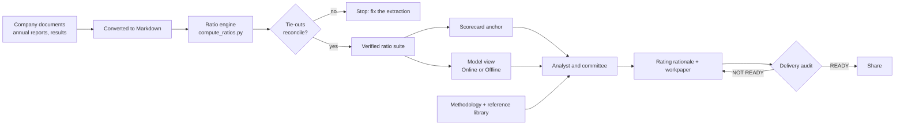

# Credit Rating Tool

A workbench for producing credit-rating rationales in the style of **ICRA, CRISIL and CareEdge**.
It combines a web app for managing cases and documents, a verified ratio engine for each case,
mechanical delivery checks, and two ways to get a rating view: **Online** (Claude API) and
**Offline** (a built-in model that runs on your own machine, no internet or key needed).

> The output is an internal analytical exercise in an agency's format. It is not a rating issued
> or endorsed by any credit rating agency.

**Contents:** [How it works](#how-it-works) · [Start it](#start-it) ·
[First start on a new machine](#first-start-on-a-new-machine) · [How to use it](#how-to-use-it) ·
[Online and Offline](#online-and-offline) · [Command line](#command-line) ·
[What is in this repository](#what-is-in-this-repository) · [Security](#security) ·
[Troubleshooting](#troubleshooting)

---

## How it works



1. **Documents become Markdown.** Everything you upload for a company is converted to Markdown
   and stored in its case folder. Ratings are built from the Markdown.
2. **Numbers are computed in code, then checked.** Each case has a `compute_ratios.py` holding
   the figures taken from the documents. Its *tie-outs* reconcile each figure against a second,
   independent disclosure. If a tie-out fails, nothing downstream runs.
3. **The verified numbers go two ways.**
   - A **scorecard** turns them into a deterministic anchor grade.
   - A **model** (Claude online, or the built-in model offline) reads the same verified numbers
     and returns a grade, outlook, strengths and weaknesses.
4. **The model never extracts figures.** It is given numbers that already reconcile and decides
   what they mean. Its text is checked afterwards: any figure it quotes that is not in the
   verified set is flagged, and so is any strength or weakness that contradicts the trend.
5. **The rationale is written by the analyst workflow** in `CLAUDE.md`, using the agency's own
   methodology and report format from the library. Neither the scorecard nor the model is the
   rating; both are inputs to that decision.
6. **A delivery audit gates the result.** It checks the tie-outs, the test coverage of the
   figures, the mandatory report sections, and the grade and outlook against the agency's own
   latest published action for the same company.

---

## Start it

| System | What to do |
|---|---|
| **Windows** | Double-click `Start Credit Rating Tool.bat` |
| **macOS / Linux** | Double-click `Start Credit Rating Tool.command`, or run it in a terminal |
| **Docker** | `docker build -t credit-rating .` then `docker run -p 127.0.0.1:5050:5050 -e RATING_PASSWORD=choose-one -v cr-models:/app/models credit-rating` |

Then open <http://localhost:5050>.

You need **Python 3.10 or newer** (tested on 3.12 and 3.14) and **git**. The launchers install the Python packages from
`requirements.txt` the first time.

## First start on a new machine

1. **Code sync.** The tool pulls the latest code from this repository. The result is shown under
   **Settings → Code sync**, including the reason if it could not sync.
2. **Offline model check.** If the offline model is already on the machine, the tool opens
   straight away. If not, it opens on a setup screen and downloads the model once (about
   5.35 GB) with a progress bar. An interrupted download resumes where it stopped. Before the
   file is used it is checked against its published SHA-256; a file that does not match is
   deleted and the setup screen says so. Press
   **Continue in Online mode instead** if you do not want to wait.
3. **Mode.** The **Online / Offline** switch in the header chooses how a rating view is
   produced. Offline is the default on a new machine.

Online mode needs an Anthropic API key. It is stored on your machine, never in this repository:

```bash
python tools/rate_engine.py --set-key
```

---

## How to use it

### 1. Pick an agency and create a case
On the home page choose **ICRA**, **CRISIL** or **CareEdge**. Create a case with the company
name, its sector, and the analytical basis (standalone or consolidated). The tool suggests the
methodology files for that sector; you can change the selection on the case page.

### 2. Upload the documents
On the case page, upload annual reports, quarterly results, presentations and any sector notes.
PDF, Word, text and HTML files are converted to Markdown automatically; the uploaded original is
not kept once the conversion succeeds.

### 3. Request the rating
Press **Request rating** on the case page. This writes a request file into the case folder.
Open the project in Claude Code and say:

```
process the pending rating requests
```

The analyst workflow then runs the steps in `CLAUDE.md`: read every document, extract the
figures into `compute_ratios.py`, reconcile them, apply the agency's methodology, form a view,
compare it with the agency's own prior action, and draft the rationale and workpaper.

### 4. Review the outputs
The rationale, workpaper and workbooks appear on the case page as they are produced. Press
**Check readiness** to run the delivery checks; the case shows **READY TO SHARE** or lists what failed.

### 5. Other pages
- **Reference Library** — browse and search the methodology files and published rationales for
  each agency.
- **Process Flow** — the step-by-step procedure the workflow follows.
- **Settings** — API key, Claude model, Online/Offline mode, and code sync.

---

## Online and Offline

| | Online | Offline |
|---|---|---|
| Model | Claude, through the Anthropic API | Built-in model, run on your machine |
| Needs | API key and internet | Nothing after the one-time model download |
| Speed | Seconds | Minutes on a normal laptop |
| Sees | The verified ratio suite | The same suite; optionally document excerpts and criteria |
| Use it for | The working rating view | A second opinion, or work without internet |

The offline model is small. It reliably returns a grade and outlook, but its supporting text is
weaker than Claude's, which is why that text is checked mechanically and any contradiction or
unverified figure is printed with the result.

---

## Command line

```bash
python tools/preflight.py <case-slug>          # what the documents and library contain
python Companies/<case-slug>/compute_ratios.py # the ratio suite and its tie-outs
python tools/rate_engine.py <case-slug>        # rating view, using the Mode switch
python tools/delivery_audit.py <case-slug>     # the delivery checks
```

Choosing the engine explicitly:

```bash
python tools/rate_engine.py <case-slug> --engine both       # scorecard + Claude (online)
python tools/rate_engine.py <case-slug> --engine embedded   # scorecard + built-in model (offline)
python tools/rate_engine.py <case-slug> --engine embedded --with-docs --with-skills
python tools/rate_engine.py <case-slug> --engine local      # scorecard only
```

`--with-docs` gives the offline model short qualitative excerpts from the case documents
(governance, management, auditor remarks). `--with-skills` gives it the agency's criteria.
Figures still come only from the verified ratio suite.

---

## What is in this repository

| Folder | Contents |
|---|---|
| `webapp/` | The web app |
| `tools/` | Ratio and rating engines, the checks, and their tests |
| `ICRA/`, `CRISIL/`, `CareEdge/` | Each agency's `Methodology/`, `Report for Reference/` and conventions notes (Markdown) |
| `Knowledge Base/` | Shared routing maps, report templates and procedure notes |
| `Companies/` | One folder per case: documents (Markdown), ratio engine, workpaper, rationale, workbooks |
| `CLAUDE.md`, `UNIFIED_RATING_GUIDE.md` | The operating procedure the analyst workflow follows |
| `Rating_Scorecard.xlsx` | The scorecard template copied into each case |

**Not in the repository:** PDFs, the offline model file (downloaded on first start into
`models/`), your API key, and per-machine settings.

## Security

By default the web app listens on `127.0.0.1` only: nothing outside your own computer can reach it,
and no login is needed.

**Serving it to other machines** (or from Docker) requires a login. The app refuses to start
on a network address without one:

```bash
python webapp/app.py --set-password    # stores a salted scrypt hash in your home folder, never the password
```

or pass `RATING_PASSWORD` as an environment variable (as in the Docker command above). Also list
the name or IP that people will type in the browser, for example
`RATING_ALLOWED_HOSTS=192.168.1.20`; any other address is refused. The built-in server speaks plain
HTTP, so beyond a trusted network put it behind an HTTPS reverse proxy.

What the app does on every request: only scripts carrying a per-page nonce may run
(Content-Security-Policy), posts from other websites are refused (CSRF), unknown `Host` names are
refused (DNS rebinding), and posts are rate-limited (60 a minute; sign-in 10 per 5 minutes).
The browser can reach only case documents, the reference library and deliverables, never source,
settings, `.git` or anything outside the project. Uploaded files other than text are downloaded,
never displayed as pages. The Werkzeug debugger (`RATING_DEV=1`) is refused on a network address.
Your API key is kept in your home folder, outside this repository.

The offline model download is pinned to one commit of IBM's Hugging Face repository and must match
its SHA-256 before it is used. To download a different model file, set `CREDITRATING_GGUF_URL`
together with `CREDITRATING_GGUF_SHA256`; a URL without a hash is refused.

## Tests

```bash
python tools/test_rate_engine.py
python tools/test_offline_agent.py
python tools/test_fm47_52.py
python tools/test_no_control_chars.py
python webapp/test_app.py
python webapp/test_security.py
```

---

## Troubleshooting

**macOS: the launcher will not open.** Right-click it and choose **Open** once, or run
`chmod +x "Start Credit Rating Tool.command"`.

**macOS: packages fail to install.** The launcher uses its own environment in `.venv/` because
Homebrew's Python refuses a plain `pip install`. If `llama-cpp-python` fails to build, run
`xcode-select --install` and start the launcher again. The tool still starts without it; only
Offline mode is unavailable.

**The model download stops.** Start the tool again, or press **Download** on the setup screen.
It continues from where it stopped.

**Settings shows "Code sync skipped".** The reason is printed beside it. The usual causes are no
internet, no saved GitHub sign-in on that machine, or a copy of the folder that is not a git
clone. The tool works without syncing; you just stay on the code you have.

**A rating will not run for a case.** Run `python Companies/<case-slug>/compute_ratios.py`. If a
tie-out fails, the engine stops on purpose until the figure is corrected.
